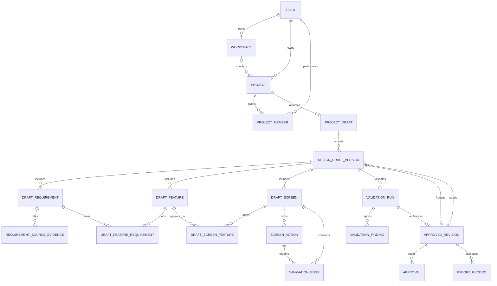

# REQVIORA persistence and database setup

The ASP.NET backend uses PostgreSQL, including Supabase deployments. The SQL
Server migration context supports the same relational persistence model and
uses SQL Server's native `rowversion` for project drafts. The application uses
the project's authenticated owner for draft, validation, approval, and export
operations. Workspace membership is persisted for the project access model.

## Entity relationships



Membership is unique per project and user. Existing projects can have a null
workspace. The current draft has one stable ID per project. Each successful
save adds a consecutively numbered design version and renews the concurrency
token. Requirement, feature, screen, and action IDs are scoped to that version.
Composite keys bind links to the same graph version. Source rows retain the
original source ID, locator, and quote.

Approval requires an explicit owner action and a passing validation run for
the exact current draft version. EF saves the snapshot, approval record, and
draft lock in one transaction. Both production database migrations reject
updates and deletes of approved snapshots and saved design versions. Starting a
new draft copies the approved content, records its parent, and advances the
draft version. Requirement review statuses are preserved in the snapshot.

## PostgreSQL and Supabase

Use the backend's `ConnectionStrings:ReqvioraDatabase` and JWT settings from the
README. Apply the additive migrations with the PostgreSQL context.

```bash
dotnet tool restore
dotnet ef database update --context ReqvioraDbContext \
  --project src/Reqviora.Infrastructure --startup-project src/Reqviora.Api
```

The migration adds row-level security and revokes Supabase Data API roles'
access to the server-owned application tables. Apply it with the database migration
owner. Existing project IDs, owner references, and optional workspace links are
preserved. The private requirement review schema has its own setup script.

## SQL Server

Supply a SQL Server connection for a database in the default `dbo` schema via
`REQVIORA_SQLSERVER_CONNECTION`. Use the dedicated project for SQL Server
migrations.

```bash
dotnet tool restore
dotnet ef database update --context SqlServerReqvioraDbContext \
  --project src/Reqviora.SqlServer.Persistence \
  --startup-project src/Reqviora.SqlServer.Persistence
```

Both providers use the caller's draft token for optimistic concurrency. In SQL
Server, EF also checks the generated eight-byte `RowVersion` on updates. The
PostgreSQL application uses its existing PostgreSQL requirement review store.

## Second Brain exports

The export service builds the canonical 19 reference files and a separate
`manifest.json` from an approved snapshot. [Canonical inventory](https://github.com/sasikarankobiga/reqviora-backend/blob/docs/second-brain/docs/second-brain/manifest.json)

Blueprint requirements and evidence feed the goals and business rules.
Features, screens, components, actions, and routes feed the catalogue, coverage,
layout, interaction, and navigation files. The approval and validation records
feed the decision register and validation report. `project.json` carries the
machine-readable approved snapshot.

Draft JSON can include a `secondBrain` object with author-entered section text
such as `designTokens`, `accessibilityRequirements`, `openQuestions`, and
`implementationChecklist`. These values are copied from the approved snapshot
into their reference files. Sections awaiting author input carry a pending
status.

The manifest binds the package to its project and approved revision and lists
the byte length and SHA-256 digest of each reference. The export record stores
the exact ZIP, manifest, and archive hash. Reads verify the file inventory and
all hashes. Repeated export requests return the existing package for that
revision and generator version.

## Integration tests

```bash
dotnet test tests/Reqviora.Infrastructure.Tests --configuration Release
```

Tests also use PostgreSQL and SQL Server when `REQVIORA_TEST_POSTGRES` and
`REQVIORA_TEST_SQLSERVER` contain connection strings to local test instances.
The tests create and clean up their own database names. CI supplies both
providers. Tests cover the PostgreSQL upgrade with existing project data,
Save/Resume and stale writes, SQL Server rowversion, graph constraints,
validation and approval, snapshot immutability, draft lineage, and tamper
detection for exported files.
